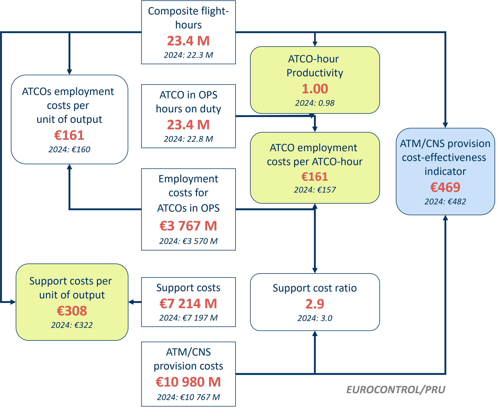
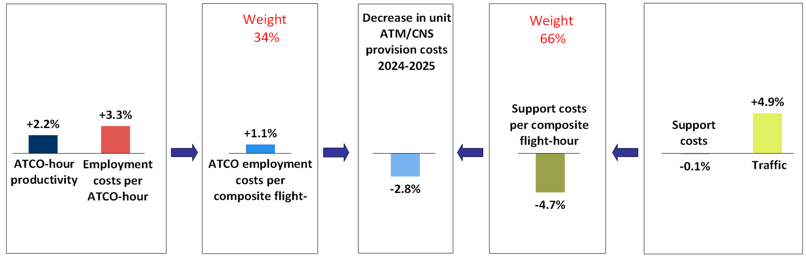

<!-- Calculate quartiles for text -->

```{r}
library(here)
source(here("R/calc_quartiles.R"))
```

# ATM/CNS provision cost-effectiveness {#sec-financial}

This chapter provides a [preliminary analysis]{.underline} of ATM/CNS provision cost-effectiveness.

## Pan-European system level {#sec-fin_1}

@fig-figure-4-1 shows that ATM/CNS costs per composite flight-hour stood at €469 in 2025, which represents the lowest level since the inception of ACE benchmarking activities in 2002. Compared to 2024, unit ATM/CNS provision costs were -2.8% lower, as traffic (+4.9%) rose faster than ATM/CNS provision costs (+2.0%). 

::: {#fig-figure-4-1 style="max-width: 550px; margin: auto"}

::: {.content-visible when-format="html"}

```{r}
#| file: R/hlsr_evo_unit_cost.R
#| echo: false
#| format:
#|   html:
#|     out.height: "300px"
#|     out.width: "100%"
```
:::

::: {.content-visible when-format="pdf" layout="[10,80,10]"}
:::: {.col-left}
\hspace*{3mm}
::::

:::: {.col-middle}
```{r}
#| file: R/hlsr_evo_unit_cost.R
```
::::

:::: {.col-right}
\hspace*{3mm}
::::
:::

Changes in unit ATM/CNS provision costs,  -  (real terms)
:::

The analytical framework used in the ACE analysis to break down the ATM/CNS provision cost-effectiveness indicator into relevant economic drivers is presented in @fig-figure-4-2. These key drivers include:

a\) ATCO-hour productivity (1.00 composite flight-hours per ATCO-hour);

b\) ATCO employment costs per ATCO-hour (€162); and,

c\) support costs per unit output (€307).



::: {.content-visible when-format="html"}
{#fig-figure-4-2 width="88%"}
:::

::: {.content-visible when-format="pdf"}
{#fig-figure-4-2 width=12cm}
:::

@fig-figure-4-3 shows that in 2025, ATCO employment costs per ATCO-hour rose by +3.3% while ATCO-hour productivity rose by +2.2% compared to 2024. As a result, ATCO employment costs per composite flight-hour increased by +1.1%. In the meantime, unit support costs fell by  4.7% due to an increase in composite flight-hours (+4.9%) while total support costs remained fairly stable (-0.1%). Consequently, in 2025, unit ATM/CNS provision costs fell by -2.8% at the Pan-European system level compared to 2024, taking into account the relative weighting of ATCO employment and support costs based on their shares of total ATM/CNS provision costs.

::: {.content-visible when-format="html"}
{#fig-figure-4-3 height="98%" width="98%"}
:::

::: {.content-visible when-format="pdf"}
{#fig-figure-4-3 width=0.98\linewidth}
:::


## ANSP level {#sec-fin_2}

All figures presented in this section show the preliminary benchmarking results for the 38 ANSPs. Because of their weight in the Pan-European system, the six largest ANSPs by cost (DFS, DHMI, DSNA, ENAIRE, ENAV and NATS) are also shown in a miniature replica of the chart (top right corner of the figures). The 1^st^ and 3^rd^ quartiles for each indicator are also shown in all figures. The gap between these two quartiles provides additional insight on the dispersion of the values.

Many factors contribute to observed differences in ANSPs’ performance. Over the years, the Performance Review Unit has identified factors which can be of an exogenous nature (i.e. those outside the control of an ANSP) or of an endogenous nature (those entirely under the ANSP’s control). A detailed list of these factors can be found in the [ACE Handbook](https://ansperformance.eu/economics/ace/ace-handbook/influencing-factors.html).

@fig-figure-4-4 presents the ATM/CNS provision gate-to-gate cost-effectiveness indicator at ANSP level for the year . The dotted lines represent the 1^st^ and 3^rd^ quartiles (€`r q1_4_4` and €`r q3_4_4`, respectively).

::: {#fig-figure-4-4}
```{r}
#| file: R/hlsr_fin_ce.R
#| format:
#|   html:
#|     out.height: "450px"
#|     out.width: "100%"
```

ATM/CNS provision gate-to-gate cost-effectiveness, 
:::

@fig-figure-4-5 presents the ATCO-hour productivity indicator at ANSP level for the year . The dotted lines represent the 1^st^ and 3^rd^ quartiles (`r q1_4_5` and `r q3_4_5`, respectively).

\hfill\break

::: {#fig-figure-4-5}
```{r}
#| file: R/hlsr_prod.R
#| format:
#|   html:
#|     out.height: "450px"
#|     out.width: "100%"
```

ATCO-hour productivity, 
:::

ATCO-hour productivity varies significantly across the ACE sample. Observed differences should be considered together with other indicators such as ATCO employment and support costs. Multiple factors influence productivity, including operational conditions (traffic levels, airspace type, number of airports), legal and socio-economic aspects (labour laws), and institutional factors (e.g. governance arrangements). More details on the ATCO-hour productivity indicator will be provided in the ACE benchmarking report.

@fig-figure-4-6 presents the employment costs per ATCO in OPS indicator at ANSP level for the year . The dotted lines represent the 1^st^ and 3^rd^ quartiles (€`r q1_4_6` and €`r q3_4_6`, respectively).

::: {#fig-figure-4-6}
```{r}
#| file: R/hlsr_atco_cost_h.R
#| format:
#|   html:
#|     out.height: "450px"
#|     out.width: "100%"
```

Employment costs per ATCO-hour, 
:::


@fig-figure-4-7 presents the support costs per composite flight-hour indicator at ANSP level for the year . The dotted lines represent the 1^st^ and 3^rd^ quartiles (€`r q1_4_7` and €`r q3_4_7`, respectively).


::: {#fig-figure-4-7}
```{r}
#| file: R/hlsr_support.R
#| format:
#|   html:
#|     out.height: "450px"
#|     out.width: "100%"
```

Breakdown of support costs per composite flight-hour, 
:::

A more detailed analysis of the changes in cost-effectiveness, ATCO-hour productivity, ATCO employment costs per ATCO-hour and unit support costs will be available in the final ACE benchmarking report.
