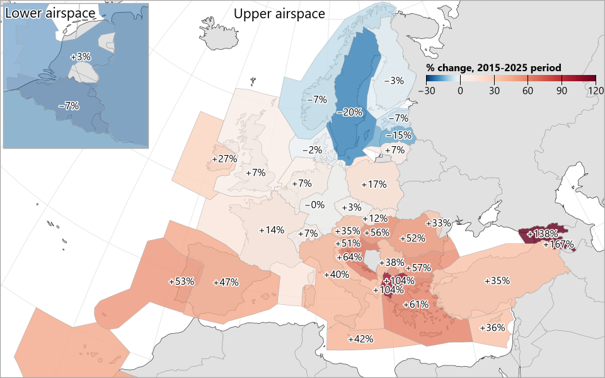

# High-level revenues, costs, staff and balance sheet data {#sec-high}

```{r load-data}
#libraries

library(tidyverse)
library(dplyr)
library(readxl)
library(here)

source(here("data_source.R"))

#import data
data_raw  <-  read_xlsx(
                        paste0(data_folder,data_file ),
                        # here("data",data_file),
                       sheet = "F_Revenue",
                       range = cell_limits(c(9, 1), c(NA, 4))) %>%
  as_tibble() %>% 
  rename(TYPE = 'Data', TOTAL = 'Grand Total') %>% 
  mutate(across(TYPE, str_replace, 'Sum of ', '')) %>% 
  filter( TYPE != "REVE_DELEGATION", TYPE != "REVE_REVENUE")

#calculate figures for text. Suffix '_f' means formatted figure -- Just an example for you to see how it could be done to avoid copy pasting
total_reve_f <- data_raw  %>% select(TOTAL) %>%  summarise(sum(TOTAL/1000000)) %>% pull() %>% round() %>% 
  format(., nsmall =0 ,big.mark= " ") %>% paste0("\u20AC", ., "M")

ert_reve <- data_raw  %>% select(ERT) %>%  summarise(sum(ERT)) %>% pull() 
ert_reve_charge <- data_raw  %>%  filter(TYPE == 'REVE_CHARGE') %>% select(ERT)  %>% pull() 
ert_reve_charge_perc <- sprintf("%0.1f%%", ert_reve_charge/ert_reve*100) 

trm_reve <- data_raw  %>% select(TRM) %>%  summarise(sum(TRM)) %>% pull() 
trm_reve_charge <- data_raw  %>%  filter(TYPE == 'REVE_CHARGE') %>% select(TRM)  %>% pull() 
trm_reve_charge_perc <- sprintf("%0.1f%%", trm_reve_charge/trm_reve*100) 

trm_reve_apt <- data_raw  %>%  filter(TYPE == 'REVE_AIRPORT') %>% select(TRM)  %>% pull() 
trm_reve_apt_perc <- sprintf("%0.1f%%", trm_reve_apt/trm_reve*100) 

```

##	Revenues and traffic

This chapter provides a [preliminary]{.underline} overview of high-level revenues, costs and staff data provided in ANSPs ACE  data submissions. 

Total ANS revenues in  amounted to `r total_reve_f`. Most en-route revenues come from the collection of en-route charges (`r ert_reve_charge_perc`, see left pie chart). The proportion of terminal revenues from charges is lower (`r trm_reve_charge_perc`, see right pie chart), as additional income may directly come from airport operators (`r trm_reve_apt_perc`) through, for example, a contractual arrangement between the ANSP and the airport operator.

```{r}
#| label: hlsr_rev_pie
#| file: R/hlsr_rev_pie.R
#| out-width: "100%"
#| format:
#|   html:
#|     out-height: "420px"
#|   pdf:
#|     fig-height: 2.7

```


::: {#fig-figure-2-1}
::: {.content-visible when-format="html"}
```{r}
#| label: hlsr_rev_gtable
#| file: R/hlsr_rev_gtable.R
```
:::

::: {.content-visible when-format="pdf"}
```{r rev_gt}
#| file: R/hlsr_rev_gtable.R
#| echo: false
#| include: false
```


```{r rev_gt_latex}
#| echo: false
#| results: asis

cat(latex_table_revenues(df = data_table_pdf))
```
:::

Breakdown of gate-to-gate ANS revenues, 
:::

Across the Pan-European system, traffic in 2025 (measured in composite flight-hours) increased by +4.9% compared to 2024.  

Taking a longer-term perspective and setting aside the exceptional disruption to air transport during the COVID-19 pandemic (mainly in 2020 and 2021), at Pan-European system level traffic continued its upward trend, with the level recorded in 2025 being +22.5% higher than in 2015 and +6.5% higher than in 2019. 


<!-- ::: {#fig-2-2 layout="[50,50]"} -->

<!-- ```{r} -->
<!-- #| file: R/hlsr_cfh_evo.R -->
<!-- #| out.height: "300px" -->
<!-- ``` -->

<!-- ```{r} -->
<!-- #| file: R/hlsr_g2g_revenues_evo.R -->
<!-- #| out.height: "300px" -->
<!-- ``` -->

<!-- Composite flight-hours (left) and gate-to-gate ANS revenues (right) of the Pan-European system, - (real terms) -->
<!-- ::: -->

::: {#fig-2-2 layout="[[-10,80,-10]]"}

```{r}
#| file: R/hlsr_cfh_evo.R
#| echo: false
#| out-width: "100%"
#| out.height: "300px"
```

Composite flight-hours of the Pan-European system, –

:::

However, at ANSP level, traffic flows and characteristics changed significantly over the 2015-2025 period, influenced by several factors. These included a) the ongoing war in Ukraine, which led to significant changes in route structures and traffic volumes due to airspace closures and reciprocal sanctions on air carriers; and b) other developments reflecting evolving demand for air transport and changes in how airspace users provide their services (e.g. increasing demand for holiday destinations, more pronounced seasonality, use of heavier aircraft flying longer routes, fewer domestic flights in some countries, etc.)[^2].

[^2]: Performance Review Report, March 2026.

As a result, eight ANSPs were still below their 2015 traffic levels in 2025 (see @fig-Traffic_map) and 16 below 2019 levels. This inevitably impacted the levels and trends of ACE indicators for the most affected ANSPs.


::: {#fig-Traffic_map}


Changes in composite flight-hours between  and 
:::

##	Costs

The ACE benchmarking analysis focuses on the specific costs of providing gate-to-gate ATM/CNS services, which amounted to €10 468M in 2025. Operating costs (including staff costs, non-staff operating costs and exceptional cost items) accounted for some 84% of total ATM/CNS provision costs, while depreciation costs and the cost of capital represented around 16%.

```{r hlsr_c_bdown_pie}
#| file: R/hlsr_c_bdown_pie.R
#| out.width: "100%"
#| format:
#|   html:
#|     out-height: "300px"
#|   pdf:
#|     fig-height: 2
```

::: {#fig-figure-2-3}
::: {.content-visible when-format="html"}
```{r hlsr_c_bdown_gtable}
#| file: R/hlsr_c_bdown_gtable.R
```
:::

::: {.content-visible when-format="pdf"}
```{r c_bdown_gtable}
#| file: R/hlsr_c_bdown_gtable.R
#| echo: false
#| include: false
```


```{r c_bdown_gtable_latex}
#| echo: false
#| results: asis

cat(latex_table_costs(df = data_table_pdf))
```
:::

Gate-to-gate ATM/CNS provision costs at Pan-European system level, 
:::

Between 2024 and 2025, ATM/CNS provision costs increased by +2.0% (+€210M). The main drivers were higher staff costs (+€417M) while all other cost categories decreased.

::: {#fig-figure-2-4}
```{r cost-category}
#| file: R/hlsr_cost_category_change.R
#| format:
#|   html:
#|     out.width: "90%"
#|     out-height: "400px"
```


Changes in gate-to-gate ATM/CNS provision cost categories (real terms)
:::

In , the six largest ANSPs in terms of costs (DSNA, DFS, ENAIRE, NATS, ENAV and DHMI) bore some 57% of the total Pan-European gate-to-gate ATM/CNS provision costs, while the six smallest ANSPs accounted for some 1% (see bottom left part of @fig-figure-2-5).

::: {.content-visible when-format="html"}
::: centeredtitle
[**Trends in ATM/CNS provision costs at Pan-European system level**]{.underline}
:::
:::

::: {.content-visible when-format="pdf"}
\begin{center}
\underline{\textbf{Trends in ATM/CNS provision costs at Pan-European system level}}
\end{center}
:::

```{r cost-evolution}
#| file: R/hlsr_evo_cost.R
#| format:
#|   html:
#|     out.height: "200px"
#|     out.width: "100%"
```

::: {#fig-figure-2-5 layout="[65,35]"}
```{r cost-per-ansp}
#| file: R/hlsr_cost_per_ansp.R
#| format:
#|   html:
#|     out.height: "600px"
```

```{r cost-per-ansp-perc}
#| file: R/hlsr_cost_per_ansp_perc.R
#| format:
#|   html:
#|     out.height: "600px"
```

Changes in ATM/CNS provision costs (real terms)
:::

## Staff

The Pan-European ANSPs employed a total of 56 146 staff (expressed in Full Time Equivalents – FTEs) in 2025 (comprising 55 309 staff providing ATM/CNS services and 837 internal MET staff). Some 17 840 staff (32%) were ATCOs working on operational duties, split between ACCs (53%) and APP/TWR facilities (47%). On average, 2.1 additional staff were required for every ATCO in OPS in Europe.

::: {#fig-figure-2-6}
```{r staff-pie}
#| file: R/hlsr_staff_pie.R
#| format:
#|   html:
#|     out.height: "300px"
#|     out.width: "100%"
```

Breakdown of total gate-to-gate ATM/CNS staff at Pan-European system level, 
:::

In 2025, the number of ATM/CNS staff increased by +2.4% (+1 278 FTEs) compared with 2024, reaching a level +8.0% above that recorded in 2015. The numbers of ATCOs in OPS and support staff rose by +1.5% (+264 FTEs) and +2.8% (+1 014 FTEs), respectively, compared with 2024. The increase in ATCOs in OPS at the Pan-European system level was mainly attributable to a change in ENAV’s reporting scope. In 2025, ENAV included 20 additional tower units serving regional airports with relatively low traffic which were previously excluded from the ACE benchmarking exercise. Excluding ENAV from the 2024-2025 comparison, the increase in the number of ATCOs in OPS would be lower (+0.4%).

::: {#fig-figure-2-7 layout="[65,35]"}
```{r staff-breakdown}
#| file: R/hlsr_staff_bdown_bar.R
#| format:
#|   html:
#|     out.height: "500px"
```

```{r staff-breakdown-change}
#| file: R/hlsr_staff_bdown_bar_perc.R
#| format:
#|   html:
#|     out.height: "500px"
```

Changes in total gate-to-gate ATM/CNS staff per staff category
:::

The overall change in staff numbers between  and  was mainly driven by the following categories:

-	Technical support staff for operational maintenance, monitoring and control: +413 FTEs (+4.5%);
-	Administrative staff: +328 FTEs (+3.7%);
-	ATCOs in OPS: +264 FTEs (+1.5%); and,
-	Technical support staff for planning and development: +183 FTEs (+5.7%).

Most other categories recorded increases, except OPS support (non-ATCOs) and Other Staff, which declined by -1.6% and -6.1%, respectively, as shown in [@fig-figure-2-7]{.no-external}. The largest proportional increase was observed in ab-initio trainees (+5.9%), indicating that some ANSPs expanded the recruitment of future ATCOs in 2025. More detailed information on staff numbers will be provided in the upcoming ACE report.

## Balance sheet structure and capital expenditures

ANSP balance sheets in 2025 comprised €10 017M in capital and reserves and €5 091M in borrowings, while capital expenditures amounted to €1 454M. 

::: {#fig-figure-2-9 layout="[[-10,80,-10]]"}

```{r}
#| file: R/hlsr_capex.R
#| echo: false
#| out-width: "100%"
#| out.height: "350px"
```

Total ANS capital & reserves and borrowings of the Pan-European system,  and  (real terms)

:::

In 2025, capital and reserves decreased by -6% ( €649M), while borrowings continued to decline, falling by -9% (-€483M). At €5.1 billion, borrowings remained significantly above their 2019 level (the lowest recorded over the 2015-2025 period) but continued to move closer to their 2015 level of €4.0 billion.


::: {#fig-figure-2-9bis layout="[[-10,80,-10]]"}

```{r}
#| file: R/hlsr_res_borrow.R
#| echo: false
#| out-width: "100%"
#| out.height: "350px"
```

Gate-to-gate capital expenditures of the Pan-European system,  and  (real terms)

:::

Although capital expenditures fell in 2025, they remained close to their 2024 level (€1.5 billion) and well above the amounts spent during 2020-2023, a period marked by liquidity constraints and considerable uncertainty about future traffic volumes.

<!-- :::: {#fig-figure-2-9} -->

<!-- ::: {.content-visible when-format="pdf" layout="[50,5,45]"} -->
<!-- :::: {.col-left} -->
<!-- ```{r reserves-borow_html} -->
<!-- #| file: R/hlsr_res_borrow.R -->
<!-- #| out-height: "350px" -->
<!-- ``` -->
<!-- :::: -->
<!-- :::: {.col-middle} -->
<!-- \hspace*{3mm} -->
<!-- :::: -->
<!-- :::: {.col-right} -->

<!-- ```{=tex} -->
<!-- \vspace*{-9mm} -->
<!-- ``` -->

<!-- ```{r capex_html} -->
<!-- #| file: R/hlsr_capex.R -->
<!-- #| out-height: "350px" -->
<!-- ``` -->
<!-- :::: -->
<!-- ::: -->

<!-- ::: {.content-visible when-format="html" layout="[50,50]"} -->
<!-- :::: {.col-left} -->

<!-- ```{r reserves-borow_pdf} -->
<!-- #| file: R/hlsr_res_borrow.R -->
<!-- #| out-height: "350px" -->
<!-- ``` -->
<!-- :::: -->

<!-- :::: {.col-right} -->

<!-- ```{r capex_pdf} -->
<!-- #| file: R/hlsr_capex.R -->
<!-- #| out-height: "322px" -->
<!-- ``` -->
<!-- :::: -->
<!-- ::: -->

<!-- Capital & reserves and borrowings (left) and capital expenditures (right) of the Pan-European system,  and  (real terms) -->

<!-- :::: -->


